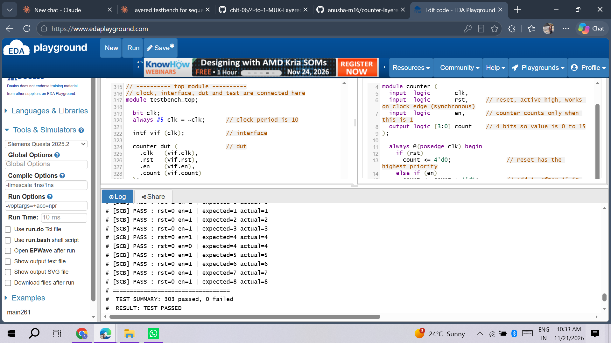
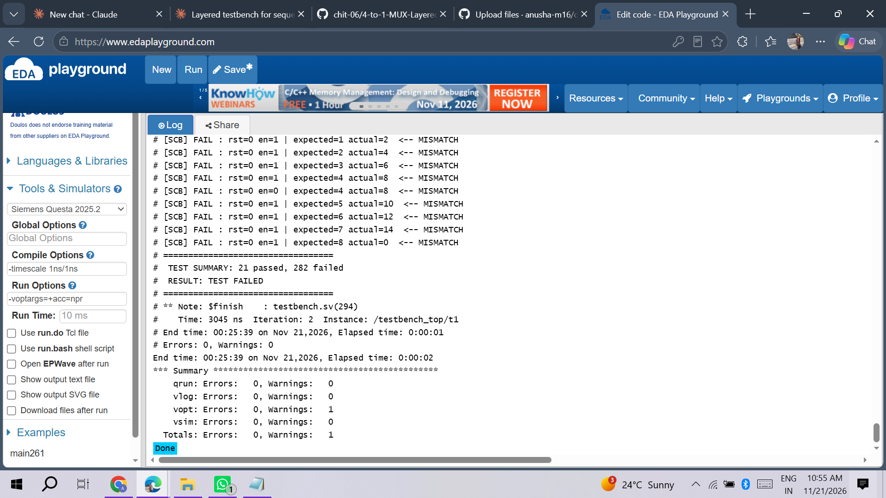
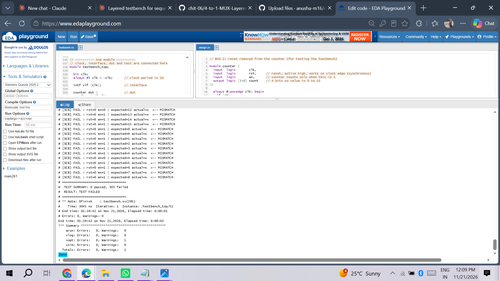

# Layered Testbench for a 4-bit Up Counter (SystemVerilog)

Layered SystemVerilog testbench to verify a 4-bit up counter with synchronous reset and enable. Made for my VLSI verification assignment.

**Name:** _Anusha M_  
**Course:** Verification of VLSI Circuits using SystemVerilog  
**Tool:** EDA Playground, simulator: Siemens Questa 2025.2

## About the project

The aim is to verify a sequential circuit using a layered testbench, the same way as the half adder example done in class. A counter was chosen because its output depends on the previous value (it has memory), so the reference model also has to remember the count.

## DUT (Design Under Test)

A 4-bit up counter.

| Signal | Direction | Description |
|---|---|---|
| `clk` | input | clock |
| `rst` | input | synchronous reset, active high. Count becomes 0 |
| `en` | input | counts only when 1 |
| `count[3:0]` | output | current count, 0 to 15, goes back to 0 after 15 |

Rules on every rising clock edge:
1. if `rst = 1`, count = 0
2. else if `en = 1`, count = count + 1
3. else count stays the same

## Testbench architecture

```
 transaction (packet)
       |
   generator --mailbox--> driver --(virtual interface)--> [ interface + DUT ]
                                                              |          |
                                                       monitor_in    monitor_out
                                                              |          |
                                                      reference model    |
                                                              |          |
                                                              +--> scoreboard <--+
```

| Block | Job |
|---|---|
| transaction | packet holding `rst`, `en` and `count` for one clock cycle |
| generator | creates random transactions and puts them in a mailbox |
| driver | takes transactions and drives `rst` and `en` on the DUT pins |
| monitor_in | samples the inputs (`rst`, `en`) every clock edge |
| monitor_out | samples the output (`count`) every clock edge |
| reference model | keeps its own count and predicts the expected output |
| scoreboard | compares expected and actual count, prints PASS or FAIL |
| environment | creates and connects everything, runs all blocks in parallel |
| test | sets the number of transactions (300) |
| testbench_top | clock, interface, DUT and test |

### Things that are different for a sequential circuit
- A clock is generated in the top module.
- The monitors sample using a clocking block (`#1step`) so there is no race with the DUT.
- The output appears one clock after the input, so `monitor_out` skips the first clock edge to keep both monitors matched.
- Reset is made rare (1 in 25) and enable is mostly on (4 in 5), so the counter reaches 15 and wraps to 0.

## Files

| File | Description |
|---|---|
| `design.sv` | the counter (DUT) |
| `testbench_single.sv` | the complete testbench in one file |

## How to run

1. Open [EDA Playground](https://www.edaplayground.com/).
2. Choose SystemVerilog/Verilog and a simulator that supports classes.
3. Paste `design.sv` in the design pane.
4. Paste `testbench_single.sv` in the testbench pane.
5. Click Run.

## Results

The testbench drives 300 random transactions. The monitors sample every clock edge, so the scoreboard checks 303 clock cycles in total (the initial reset cycle and a few extra clocks at the end are included).

- Transactions driven: 300
- Clock cycles checked: 303
- Passed: 303
- Failed: 0
- Result: TEST PASSED

Screenshot of the output:



Bug 1 (counts by 2):



Bug 2 (reset removed):



### Bug injection

To check the testbench really catches errors, the DUT was changed on purpose:

| Bug | Result |
|---|---|
| reset removed | 0 passed, 303 failed. The counter output stayed `x` and the scoreboard reported mismatches such as expected=2, actual=x. TEST FAILED |
| counts by 2 | 21 passed, 282 failed. The scoreboard reported mismatches such as expected=1, actual=2. TEST FAILED |

## What I learned

- How a layered testbench is split into generator, driver, monitors, reference model and scoreboard.
- For a sequential circuit the reference model needs memory, and the monitors must be timed with the clock (the output shows up one clock after the input).
- A testbench must be tested too. I broke the DUT on purpose and found that declaring `count` as `bit` hid unknown (`x`) values, so I changed it to `logic`.
